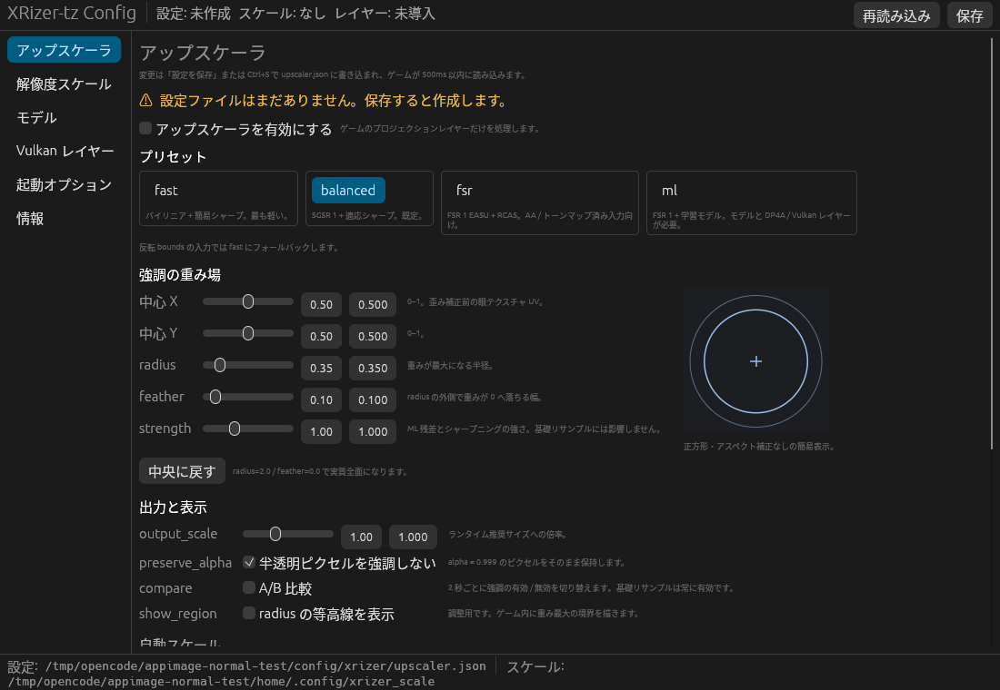

# XRizer-tz Config

XRizer-tz-Custom の実験的空間アップスケーラと学習用キャプチャを、デスクトップ GUI から安全に設定するためのアプリです。egui / eframe で作られており、Linux（X11 / Wayland）で動作します。

見た目よりも操作性と安全性を優先しています。項目の意味が分かること、変更が確実に本体へ届くこと、壊れた設定ファイルを出さないことを重視しています。

## できること

- `~/.config/xrizer/upscaler.json` の全 14 項目を編集（実際は本体の優先順位で決まる実効ファイル）
- 未知のキーを値と順序を保ったまま書き戻す
- 壊れた JSON は上書きせず、警告と生ファイル表示を出す
- `xrizer_scale` を、本体が実際に読む実効パスへ書く
- `.xru` モデルを検証し、`~/.config/xrizer/upscaler_model.xru` へ安全に配置
- Vulkan レイヤーの導入状態を表示し、同梱インストーラで導入・削除
- `XRIZER_CAPTURE` 系と `XRIZER_UPSCALER_VK_LAYER` を含む Steam 起動オプションを生成・コピー
- 外部変更の検出と競合表示。保存直前にも内容を再確認

## 画面

左サイドバーで 6 つのタブを切り替えます。

1. **アップスケーラ** — 有効化、プリセット、重み場（中心・半径・減衰・強度）、出力倍率、フラグ、自動スケール、`model_path`
2. **解像度スケール** — 実効パスと候補一覧、倍率の編集、揮発性の警告
3. **モデル** — 現在使われるモデルの情報、`.xru` の検証と配置、`model_path` の解除
4. **Vulkan レイヤー** — `.so` の選択・検証、導入状態、インストール / 削除、ログ
5. **起動オプション** — レイヤー有効化、キャプチャ設定、パス固定、Steam 起動オプションの生成とコピー
6. **情報** — 解決したパス、環境値、同梱物の出所、ライセンス

上部バーに設定 / スケール / レイヤーの状態、`再読み込み`、`保存`、未保存表示があります。下部バーに実効パスを表示します。

## 必要環境

- Linux（X11 または Wayland）
- Rust 1.95 以上（ビルドする場合）
- XRizer-tz-Custom の `main`（空間アップスケーラとキャプチャを含む）
- `ml` プリセットを使う場合のみ Vulkan とビルド済みの `libxrizer_upscaler_layer.so`

Ubuntu / Debian 系でビルドする場合の依存パッケージ例:

```bash
sudo apt-get install -y \
  build-essential pkg-config \
  libxcb-render0-dev libxcb-shape0-dev libxcb-xfixes0-dev \
  libxkbcommon-dev libwayland-dev libx11-dev \
  libgl1-mesa-dev libegl1-mesa-dev
```

ファイルダイアログは `xdg-desktop-portal` を使います。ポータルが使えない環境では、パスを直接入力できます。

## ビルドと起動

```bash
git clone https://github.com/TommyZ-7/XRizer-tz-Config.git
cd XRizer-tz-Config
cargo build --release
./target/release/xrizer-tz-config
```

開発中は `cargo run` でも起動できます。

### AppImage

1 ファイルで配布できる AppImage を生成できます。

```bash
bash scripts/build-appimage.sh
./dist/XRizer-tz-Config-0.1.2-x86_64.AppImage
```

GitHub Release / Actions artifact からダウンロードした場合は、実行ビットが落ちているため次を実行してください。

```bash
chmod +x XRizer-tz-Config-0.1.2-x86_64.AppImage
./XRizer-tz-Config-0.1.2-x86_64.AppImage
```

- Release 用は GitHub Actions の Ubuntu 22.04（glibc 2.35）でビルドします。x86_64 のみです。ローカルビルドはホストの glibc に依存するため、配布用は CI の成果物を使ってください。
- `linuxdeploy` / `appimagetool` はスクリプトが pinned version を取得します。
- Noto Sans CJK JP を同梱しているため、日本語フォントがない環境でも UI を表示できます（SIL OFL 1.1、`assets/fonts/OFL.txt`）。
- AppImage のフォント構成は同梱 Noto CJK のみを使い、ホストの fontconfig 設定には依存しません。ホストの古い / 新しい fontconfig との互換性問題を避けるためです。
- fontconfig / freetype / expat / xkbcommon / X11 / xcb / wayland-client は AppImage に同梱します。OpenGL / EGL / Vulkan ドライバと glibc はホストのものを使うため、通常の Linux デスクトップ環境が必要です。
- AppImage type 2 の通常起動には FUSE2 が必要です。
  - Debian / Ubuntu: `sudo apt install libfuse2`
  - Arch / CachyOS: `sudo pacman -S fuse2`
  - FUSE2 がない場合: `APPIMAGE_EXTRACT_AND_RUN=1 ./dist/XRizer-tz-Config-0.1.2-x86_64.AppImage`
- `v*` タグを push すると GitHub Release に AppImage が添付されます。手動実行（`workflow_dispatch`）では artifact として保存されます。
- リリース: https://github.com/TommyZ-7/XRizer-tz-Config/releases/tag/v0.1.2



## 設定ファイルのパス優先順位

### `upscaler.json`

本体は次の順で「最初に存在するファイル」を読みます。GUI も同じファイルを編集します。

1. `$XRIZER_UPSCALER_CONFIG`
2. `$XDG_CONFIG_HOME/xrizer/upscaler.json`
3. `$HOME/.config/xrizer/upscaler.json`
4. `$XDG_RUNTIME_DIR/xrizer_upscaler.json`
5. `/tmp/xrizer_upscaler.json`

ファイルが 1 つもない場合、GUI は書き込み可能な最初の候補（通常は `~/.config/xrizer/upscaler.json`）へ新規作成します。

**重要:** 最優先の既存ファイルが壊れている場合、本体は下位ファイルへフォールバックせず、最後に正常だった設定を使い続けます。GUI も下位ファイルへ切り替えず、そのファイルを「読込エラー」として表示し、上書きしません。

### `xrizer_scale`

1. `$XRIZER_SCALE_FILE`
2. `$XDG_RUNTIME_DIR/xrizer_scale`
3. `$HOME/.config/xrizer_scale`
4. `$HOME/.local/share/xrizer_scale`
5. `/tmp/xrizer_scale`

本体は最初に「存在して数値として読める」ファイルを使います。GUI も同じ順で実効パスを決め、**その 1 本だけ**に書きます。

有効なファイルが 1 つもない場合、GUI は新規作成先として永続候補（`~/.config/xrizer_scale`、`~/.local/share/xrizer_scale`）を揮発候補（`$XDG_RUNTIME_DIR`、`/tmp`）より優先します。永続候補が書けない場合だけ揮発候補を使い、警告します。

実効パスが揮発候補の場合は、ログアウト後の値（下位の永続ファイル、または既定値 1.0）を表示します。

## 安全動作

### 明示保存

設定とスケールは「保存」ボタンまたは `Ctrl+S` を押したときだけ書き込みます。自動保存はしません。未保存の変更は上部バーに表示されます。

### 原子的書き込み

- 同一ディレクトリの一時ファイルへ書き、`fsync` してから rename します。
- 設定・スケール・モデルは置換前に `.bak` を 1 世代残します。
- 書き込み失敗時は元ファイルを変更しません。
- シンボリックリンクはリンク自体を残し、リンク先を更新します。

### 壊れた JSON を上書きしない

次の場合は「読込エラー」として扱い、設定の保存を無効化します。

- UTF-8 でない
- JSON として不正
- トップレベルがオブジェクトでない
- 既知キーの型が違う

生ファイルの先頭 64 KiB を表示し、`エディタで開く` と `再読み込み` を提供します。自動修復はしません。スケール・モデル・レイヤー・起動オプションは引き続き使えます。

### 未知キーの保持

既知の 14 キーだけを現在値で上書きし、それ以外のキーは値も順序もそのまま残します。未知キーの件数と内容はアップスケーラタブで確認できます。

### 外部変更と競合

1 秒ごとに設定ファイルとスケールファイルの内容を確認します。

- 未編集なら自動で再読込します。
- 編集中なら競合バナーを出し、`再読み込み（変更を破棄）` か `このまま保存（上書き）` を選ばせます。
- 保存直前にもう一度内容を確認します。

`auto_scale` が有効な場合、本体が `xrizer_scale` を 0.05 刻みで書き換えます。スケールタブに警告を表示します。手動保存した値は、次の自動調整で上書きされる可能性があります。

## モデル

既定パスは本体と同じ `$HOME/.config/xrizer/upscaler_model.xru` です（`XDG_CONFIG_HOME` は使いません）。

- 配置前に XRU1 ヘッダとレイヤーテーブルを検証します。
- 種別（MLP / Residual CNN / Offset）、feature count、hidden / channels、レイヤー形状を表示します。
- 既存モデルは `upscaler_model.xru.bak` に退避してから置き換えます。
- `model_path` は絶対パスのみ受け付けます。先頭の `~` は `$HOME` に展開します。相対パスは保存をブロックします。
- `model_path` が既定パス以外を指す場合、既定パスへの配置は使われません。モデルタブから `model_path` を `null` に戻せます。

## Vulkan レイヤー

`ml` の DP4A 経路にだけ必要です。`fast` / `balanced` / `fsr` には不要です。導入に失敗してもゲームは起動し、ML は FSR にフォールバックします。

1. XRizer 側で `libxrizer_upscaler_layer.so` をビルドします（例: `cargo xbuild`）。
2. アプリの Vulkan レイヤータブで `.so` を選択します。
3. `インストール / 更新` を押します。
4. 起動オプションタブで `XRIZER_UPSCALER_VK_LAYER=1` を有効にします。
5. ゲームを再起動します。

インストール先:

- manifest: `$XDG_DATA_HOME/vulkan/implicit_layer.d/xrizer_upscaler_layer.json`
- library: `$XDG_DATA_HOME/xrizer/vulkan-layer/libxrizer_upscaler_layer.so`

`$XDG_DATA_HOME` が未設定の場合は `$HOME/.local/share` を使います。root 権限は不要です。

上級者向けに `VK_ADD_IMPLICIT_LAYER_PATH` を起動オプションへ追加できます。Steam Linux Runtime などでゲーム側の `HOME` / `XDG_*` が GUI と違う場合の保険です。Vulkan loader 1.3.296+ が必要です。

導入状態はファイルの存在で判定します。実際に Vulkan ローダーが読んだかは `VK_LOADER_DEBUG=layer` で確認してください。

同梱物は XRizer-tz-Custom `main` の commit `e6fbdd4` から取得しています。詳細と sha256 は `assets/README.md` を参照してください。

## Steam 起動オプション

起動オプションタブで設定し、生成された 1 行を Steam の「起動オプション」へ貼り付けます。`%command%` は必ず末尾に付きます。

例:

```text
XRIZER_CAPTURE=1 XRIZER_CAPTURE_DIR='/home/user/xrizer-captures/VRChat/scene-a' XRIZER_CAPTURE_MODE=interval XRIZER_CAPTURE_INTERVAL_MS=500 XRIZER_CAPTURE_MAX_PAIRS=300 XRIZER_UPSCALER_VK_LAYER=1 %command%
```

値は POSIX シェル向けにクォートされます。空白・引用符・`$` などを含むパスも扱えます。改行や NUL を含む値は拒否します。

キャプチャ環境変数とレイヤー有効化はゲーム起動時にしか読まれません。変更後はゲームを再起動してください。

### キャプチャの既定値

- `XRIZER_CAPTURE_MODE`: `interval`（既定）または `shutter`
- `XRIZER_CAPTURE_INTERVAL_MS`: 500（100〜60000）
- `XRIZER_CAPTURE_MAX_PAIRS`: 300（1〜100000）
- `XRIZER_CAPTURE_HOLD_MS`: 250（100〜500、shutter のみ）
- `XRIZER_CAPTURE_LOCKOUT_MS`: 1000（200〜5000、shutter のみ）
- `XRIZER_CAPTURE_SCENE`: 任意。空なら出力しません

shutter モードは、両手のグリップ + トリガーを同時に保持すると 1 ペア撮影します。入力はゲームにもそのまま伝わります。

## 制限

- Linux のみ。Windows / macOS には対応していません。
- ゲームの起動や VR 内プレビューは行いません。
- GUI とゲームの環境変数が違う場合、実効パスがずれる可能性があります。起動オプションのパス固定で緩和できます。
- `$XDG_RUNTIME_DIR` / `/tmp` のスケールファイルは揮発性です。
- レイヤーの導入状態はファイル存在ベースで、Vulkan ローダーが実際に読んだことは保証しません。
- `ml` はモデル・DP4A・Vulkan レイヤーのすべてが揃わないと FSR にフォールバックします。
- キャプチャ環境変数とレイヤー有効化はゲーム再起動が必要です。
- 同梱インストーラは特定 commit のコピーです。XRizer 側のレイヤー構成が変わったら更新が必要です。
- XDG ポータルが使えない環境では、ファイルダイアログの代わりにパスを直接入力してください。

## 開発

```bash
cargo fmt --check
cargo clippy --all-targets -- -D warnings
cargo test
cargo build --release
bash scripts/build-appimage.sh
```

AppImage のローカルビルドには `patchelf`、`mksquashfs`、`file`、`curl`、`unzip` が必要です。FUSE2 がない環境ではビルドツールを `APPIMAGE_EXTRACT_AND_RUN=1` で実行するため、そのままビルドできます。

テストは実ユーザーの `$HOME` / `$XDG_*` を変更せず、一時ディレクトリと合成 `Env` を使います。レイヤー導入テストは一時 `XDG_DATA_HOME` に対して実際に同梱スクリプトを実行します。

設計書: `docs/superpowers/specs/2026-11-05-xrizer-tz-config-design.md`
実装計画: `docs/superpowers/plans/2026-11-05-xrizer-tz-config.md`

## ライセンス

GPL-3.0-or-later。

同梱する `assets/install-vulkan-layer.sh` と `assets/manifest.json.in` は XRizer-tz-Custom（GPL-3.0-or-later）由来です。出所と sha256 は `assets/README.md` に記録しています。
